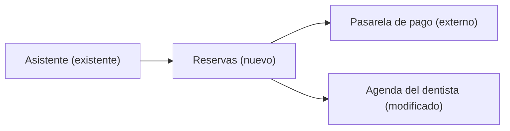

# Taller 4 — Escribe diseños técnicos

## Apertura

**Qué construimos:** el conector Buildwise, un servidor [MCP](https://modelcontextprotocol.io) (el protocolo con el que un agente usa servicios externos) que trae el método del curso a tu agente.

**Qué problema resuelve:** aplicar el método sin salir de donde trabajas.

**Dónde estamos:** en el taller 3 escribimos la [spec del conector](https://github.com/FRD898/buildwise/blob/main/docs/specs/conector-buildwise.md). Dejó cinco `[PENDIENTE]` para el diseño técnico.

**Un cambio de plan:** el feedback fue que había mucha teoría. Hoy no cerramos con un documento: diseñamos, revisamos y construimos.

**Qué hacemos hoy:** un diseño técnico corto, una revisión breve, y el conector con sus pruebas. Punto de control de partida: `taller-04-inicio`. Si te sumas hoy:

```
git clone https://github.com/FRD898/buildwise && cd buildwise
git checkout taller-04-inicio && pnpm install
```

## Pregunta

**¿Alguna vez un agente te construyó algo que funcionaba por sí solo, pero no encajaba con el resto: duplicaba algo que ya existía o rompía otra parte?**

Respóndelo en el chat, o si ves la grabación, pausa y piénsalo. Guarda tu respuesta: la retomamos al final.

## Un cambio necesita diseño por su riesgo, no por su tamaño

En el taller 3: un arreglo puntual no necesita spec. Hoy, la misma pregunta, ahora para el diseño.

| Si el cambio… | Entonces | Ejemplo |
|---|---|---|
| Es un arreglo puntual y no cambia qué hace el producto | Se pide directo, sin spec ni diseño | Corregir un texto o cambiar un color del sitio |
| Agrega o cambia algo que el producto hace, usando lo que ya existe | Spec, sin diseño | Una página nueva en el sitio: usa lo que ya hay |
| Crea un componente nuevo, guarda datos, expone algo que otros llaman o es difícil de deshacer | Spec **y** diseño | El conector: un servidor MCP nuevo que otros agentes llaman |

Esta tabla responde la primera pregunta de la rúbrica [`criterios/revisar-diseno.md`](/criterios/revisar-diseno): "¿Hacía falta un diseño?". Un revisor puede concluir "esto no necesitaba diseño", y eso también es una revisión válida.

## Un diseño técnico muestra dónde encaja lo nuevo, sin código

| Va | No va |
|---|---|
| Componentes y cómo se conectan: nuevo, existente o modificado | Código, ni "casi código" |
| Qué datos existen y de dónde salen | Nombres de funciones y archivos, carpetas, versiones |
| El contrato hacia afuera: qué recibe, qué devuelve, qué pasa si falla | Decisiones pequeñas y fáciles de cambiar: el agente las resuelve solo |
| Decisiones, con las alternativas descartadas | Lo que ya dice la spec: se enlaza |
| Riesgos: seguridad, qué pasa con lo que ya existe, cómo se deshace; o "no aplica" y por qué | |
| Lo que no se sabe, con quién lo decide | |

Cada componente se marca nuevo, existente o modificado: así no construyes algo que ya existe.

## El diagrama del diseño técnico es texto

Mermaid: texto que se dibuja como diagrama. Lo escribe el agente, vive en el repo y se revisa en el PR. En la terminal es texto; GitHub o tu editor lo dibujan. Si vas a leerlo donde no se dibuja, puede ser ASCII: cajas y flechas hechas con caracteres. Ejemplo, un asistente que reserva citas en el dentista:



El asistente ya existía y no cambia. La agenda ya existía y este cambio la toca. Reservas no existía. La pasarela es de un tercero.

Nuestra plantilla: [`templates/diseno-tecnico.md`](/plantillas/diseno-tecnico). Se revisa con [`criterios/revisar-diseno.md`](/criterios/revisar-diseno). Es una guía, no un formulario: "Datos" y "Contrato externo" se sacan si no aplican; lo demás va, aunque sea en una línea.

Lo que el diseño no dice, lo decide el agente. Si es un detalle, bien; si es una decisión grande, tiene que estar escrita.

## Parte 1 — El agente escribe el diseño

```
Lee docs/specs/conector-buildwise.md completa,
docs/adrs/distribuir-como-servidor-mcp.md, templates/ y criterios/.

Escribe docs/system-design/conector-buildwise.md, el diseño técnico del conector,
con templates/diseno-tecnico.md.
Antes de escribir, investiga y compara al menos dos alternativas para cada
decisión grande (herramientas, recursos o prompts de MCP; cuántas
herramientas y si listan o buscan; cómo se sirve el contenido; cómo
llega el agente del alumno al servidor remoto; si va dentro del sitio o
aparte) y di por qué descartas las otras. El sitio ya se publica en Vercel
desde main.
Para las herramientas, toma como referencia
https://www.anthropic.com/engineering/writing-tools-for-agents. Si una
recomendación cambia una decisión, dilo en esa decisión.
```

## Mientras escribe: qué ofrece MCP

El diseño va a elegir entre herramientas, recursos y prompts de MCP. Para juzgar esa decisión, pídele a tu asistente (claude.ai u otro) una explicación visual corta:

```
Explícame MCP (Model Context Protocol) en una sola página interactiva, para
alguien que va a construir su primer servidor MCP de solo lectura.
Quiero ver: quién llama a quién (cliente, servidor, modelo), la diferencia
entre herramientas, recursos y prompts con un ejemplo de cada uno, y qué
viaja en una llamada a una herramienta. Nada de instalación.
```

**Contrasta una afirmación** con la página oficial: [Architecture overview — MCP](https://modelcontextprotocol.io/docs/learn/architecture). La IA explica rápido; la fuente oficial manda. Si no coinciden, gana la fuente.

## Revisión breve — otro agente revisa primero

Ábrela en una **sesión nueva**: el revisor parte de los documentos, sin la conversación que los produjo, igual que quien va a construir.

```
Revisa docs/system-design/conector-buildwise.md con criterios/revisar-diseno.md.
Máximo 5 hallazgos, los que bloquean construir primero.
```

**Solo se corrige lo que bloquea construir.**

## Leer el diseño en cinco preguntas

Con los hallazgos al lado, léelo en el orden de la plantilla:

- **Diagrama:** ¿qué ya existe? ¿Lo duplica?
- **Contrato:** ¿qué responde si piden una plantilla que no existe?
- **Decisiones:** ¿qué eligió, y por qué descartó las otras opciones?
- **Seguridad:** ¿qué pasa si piden un nombre con `../` (salirse de la carpeta)?
- **Pendientes:** ¿cada uno de los cinco de la spec tiene respuesta, o dice quién y cuándo lo decide?

Decide tú cuáles hallazgos bloquean, y llévalos a la sesión que escribió el diseño:

```
Aplica estos hallazgos al diseño: [pega los que bloquean].
Los demás no se corrigen hoy.
```

Anota cómo se inicia el servidor y cómo se conecta: lo usas en la Parte 3. Si el diseño trae código, pídele que lo saque: es justo lo que no va.

## Parte 2 — Las pruebas salen de la spec, y primero fallan

Cada prueba sale de un criterio de la spec y lo cita por su identificador (`CONECTOR-1`), antes de que exista el código.

```
Lee docs/specs/conector-buildwise.md y docs/system-design/conector-buildwise.md.

Primero las pruebas, sin escribir el conector:
- Una por cada criterio CONECTOR-1, 2, 3, 4, 13 y 14, con su identificador
  en el nombre.
- Una más: un nombre con "../" debe recibir "no existe".
Llaman al conector por MCP, como lo haría un agente. Córrelas con pnpm test
y muéstrame que fallan.

Después construye el conector según el contrato y la ubicación del diseño.
Corre pnpm test hasta que pasen, sin cambiar las pruebas.
```

- **Que fallen primero:** si pasan sin código, no prueban nada. Lee por qué fallan: tiene que ser porque falta el conector.
- **Lo que el agente decidió solo:** ¿faltaba en el diseño o era un detalle?

## Parte 3 — Conéctalo a tu agente, fuera del repositorio

Con el servidor corriendo en otra terminal, como dice el diseño, conéctalo desde una carpeta nueva, **fuera del repositorio**:

```
mkdir prueba-conector && cd prueba-conector

# usa el puerto que imprime el servidor y la ruta del contrato
claude mcp add --transport http buildwise http://localhost:<puerto>/<ruta>
```

Abre `claude` ahí y comprueba con `/mcp` que `buildwise` aparece conectado. Si no, o si el agente no lo usa, prueba el servidor sin agente: `npx @modelcontextprotocol/inspector --server-url <la misma URL> --transport http` abre una página donde ves sus herramientas y puedes llamarlas. Si responde, el problema no es el servidor.

**Por qué fuera:** dentro del repo, el agente encuentra los archivos en el disco y no usa el conector.

Al terminar, desde esa carpeta: `claude mcp remove buildwise`. Luego puedes borrarla.

## Parte 4 — Tres pedidos, con la predicción antes

**Tu predicción:** ¿en cuántos de los 3 pedidos usará el conector?

1. "pásame la plantilla de PRD del curso"
2. "necesito el template de la spec"
3. "estoy empezando un producto, ¿con qué documento arranco?" (el que no nombra el documento, del taller 2)

Mira dos cosas: si usó el conector (la sesión muestra la llamada a `buildwise`), y si mostró el contenido sin cambiarlo (CONECTOR-6).

**El 3 puede fallar:** está fuera de esta versión de la spec. Si falla, es información, no un error.

## Cierre

**Volvamos a la pregunta de apertura:** algo que funcionaba solo, pero no encajaba. Hoy el diagrama mostró dónde entraba el conector antes de escribir código. El diseño no tuvo código. Y el código se comprobó contra la spec, con las pruebas pasando.

**Resultado del taller:**

- `docs/system-design/conector-buildwise.md` — el diseño técnico del conector, revisado.
- El conector y sus pruebas, una por criterio, pasando.

Punto de control de cierre: `taller-04-fin`.

## Para tu proyecto y lo que sigue

**Material de referencia:**

- [`templates/diseno-tecnico.md`](/plantillas/diseno-tecnico) — la plantilla de diseño técnico.
- [`criterios/revisar-diseno.md`](/criterios/revisar-diseno) — la rúbrica para revisarlo.

**Para tu proyecto:** toma la funcionalidad de tu spec del taller 3 y ubícala en la tabla de "Un cambio necesita diseño por su riesgo". Si cae en la tercera fila (spec y diseño), pídele al agente el diseño con la plantilla y que otro agente lo revise con la rúbrica. El prompt de la Parte 1 sirve. Cambia las rutas de la spec y del diseño, y la lista de decisiones grandes por las tuyas. Saca el artículo de Anthropic si tu funcionalidad no expone herramientas a un agente.

**Lo que sigue:** entre este taller y el taller 5, lo de hoy pasa por PR, revisión y publicación. El taller 5 es sobre el entorno: trabajar con varios agentes a la vez, y skills.

## Extra — de las pruebas a la publicación

El flujo después de las pruebas, hecho con lo de hoy:

1. **Commit** del diseño, las pruebas y el conector.
2. **PR** contra `main`.
3. **Revisión automática:** un agente revisor comenta el PR.
4. **Corregir** lo que bloquea, y **merge**: el sitio se vuelve a publicar.

La revisión de código en serio es el taller 9.

## Extra — postular el conector a los directorios

Cuando el conector esté publicado (taller 9), puede postularse a los directorios de Claude y de ChatGPT, para que otros lo encuentren sin instalar nada a mano.

| Directorio | Cómo se postula | Qué piden |
|---|---|---|
| Conectores de Claude | [Portal de desarrolladores de Claude](https://claude.ai/directory/manage) | Servidor remoto por HTTPS, autenticación (ninguna si los datos son públicos), herramientas con título y anotación de solo lectura, y revisión |
| Plugins de ChatGPT | Paquete ZIP desde la [página de Plugins de OpenAI](https://platform.openai.com/plugins) | Servidor MCP remoto en HTTPS público, identidad de desarrollador verificada, y revisión |

Nuestro conector es el caso más simple: contenido público, sin login.

## Extra — documento de diseño largo vs. diseño técnico

| | Documento de diseño largo | Diseño técnico (el del curso) |
|---|---|---|
| **Cuándo** | Equipos grandes, cambios caros de deshacer | Un componente nuevo, un equipo chico con agentes |
| **Detalle** | Hasta casi el código | Flujo, datos, contrato, alternativas |
| **Riesgo** | Se revisa dos veces: en el documento y en el PR | Huecos que el agente decide solo |

Un documento largo no es malo: el detalle debe seguir al riesgo.

## Extra — para leer: diseño

- [Design Docs at Google — Malte Ubl](https://www.industrialempathy.com/posts/design-docs-at-google/) — qué lleva un documento de diseño y cuándo no hace falta.
- [Documentation Best Practices — Google](https://google.github.io/styleguide/docguide/best_practices.html) — el documento de diseño como archivo de decisiones.
- [Is Design Dead? — Martin Fowler](https://martinfowler.com/articles/designDead.html) — cuánto diseñar por adelantado.
- [Understanding Spec-Driven-Development: Kiro, spec-kit, and Tessl — Birgitta Böckeler (2025)](https://martinfowler.com/articles/exploring-gen-ai/sdd-3-tools.html) — el riesgo de specs y diseños demasiado pesados con agentes.
- [Companies Using RFCs or Design Docs — Gergely Orosz](https://blog.pragmaticengineer.com/rfcs-and-design-docs/) — plantillas reales de varias empresas.
- [The System Design Primer — Donne Martin](https://github.com/donnemartin/system-design-primer) — fundamentos, gratis.
- [Mermaid: flowchart](https://mermaid.js.org/syntax/flowchart.html) — la sintaxis del diagrama de hoy.
- [C4 model — Simon Brown](https://c4model.com/) — el diagrama correcto para cada lector.
- [Contract Test — Martin Fowler](https://martinfowler.com/bliki/ContractTest.html) — qué son las pruebas de la Parte 2.

## Extra — para leer: MCP

- [Architecture overview — MCP](https://modelcontextprotocol.io/docs/learn/architecture) — la fuente para contrastar la explicación.
- [Writing effective tools for AI agents — Anthropic (sept. 2025)](https://www.anthropic.com/engineering/writing-tools-for-agents) — descripciones de herramientas, y cómo evaluarlas.
- [MCP Inspector](https://modelcontextprotocol.io/docs/tools/inspector) — probar un servidor sin agente.
- [The lethal trifecta — Simon Willison (2025)](https://simonwillison.net/2025/Jun/16/the-lethal-trifecta/) — el riesgo de conectar agentes a datos.
- [Distribuir el contenido del curso como servidor MCP](https://github.com/FRD898/buildwise/blob/main/docs/adrs/distribuir-como-servidor-mcp.md) — por qué MCP y no una skill; decidido en el taller 2.
