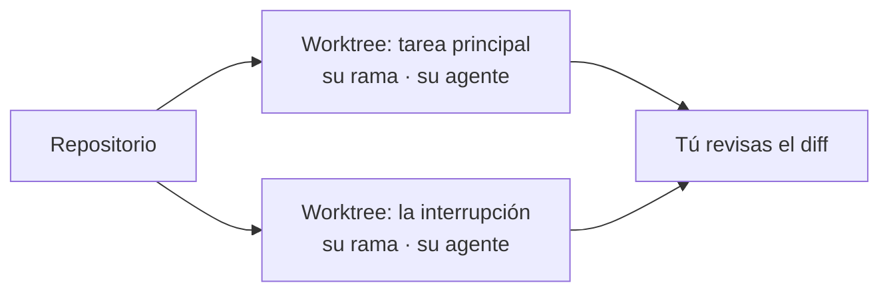

# Taller 5 — Prepara tu entorno

## Apertura

**Qué construimos:** el entorno de trabajo: dónde vive cada tarea y cómo revisas lo que hace el agente.

**Qué problema resuelve:** atender varias tareas a la vez sin que se pisen.

**Dónde estamos:** en el taller 4 construimos el [conector](https://github.com/FRD898/buildwise/blob/main/docs/system-design/conector-buildwise.md) y sus pruebas.

**Qué hacemos hoy:** una tarea por espacio, y tú revisas. Es una demostración; el material para montarlo está en Extra. Punto de control de partida: `taller-05-inicio` (el producto no cambia hoy).

## Pregunta

**Estás a mitad de una tarea y llega un bug urgente. ¿Qué haces con lo que tenías a medias?**

Respóndelo en el chat, o si ves la grabación, pausa y piénsalo. Guarda tu respuesta: la retomamos al final.

## El entorno tiene capas, y cada salto responde a un dolor

| Capa | El dolor que resuelve | Ejemplos |
|---|---|---|
| Terminal | Correr comandos | La de tu sistema, Warp |
| Agente | Copiar y pegar entre el chat y el código | Claude Code, Codex |
| Editor | Ver el código mientras el agente lo cambia | Cursor, VS Code |
| **Orquestador** (hoy) | Varias tareas a la vez, sin que se pisen | Orca, Paradev (antes Superset), Conductor, T3 Code, Herdr |
| Nube | Delegar sin tu máquina encendida | Claude Code en la web, Codex cloud |

Claude Code y Codex son el *harness*: el programa que le da al modelo herramientas y permisos. El orquestador no reemplaza al agente: lo abre.

## Una tarea, un espacio, un agente; y tú revisas



Un worktree es otra carpeta del mismo repo, con su rama.

## Un worktree aísla el código, no la máquina

| Aísla | No aísla |
|---|---|
| Archivos y rama | Puertos: dos `pnpm dev` no caben en el 3000 |
| Lo que el agente edita | Lo ignorado por git (`.env`, `node_modules`): no llega; se copia o se instala |
| | La base de datos local |
| | Lo que un comando hace fuera de la carpeta |

**Trampa de este repo:** el segundo `pnpm dev` va al 3001; `pnpm test`, siempre al 3000. Receta en Extra.

## Una skill nace de algo que repites, y se retira cuando sobra

| Skill del docente | Nació de | Qué pasó |
|---|---|---|
| `atomic-commits` | Hacer commits y PR | Sigue: hoy en vivo |
| `greptile-resolve` | Responder al revisor automático (Greptile) en el PR | Sigue en uso |
| `comment-review` | Quitar comentarios de más | Retirada: el modelo ya no los deja |

**Una buena skill:** se dispara con tus frases reales · propone y espera tu sí · cada regla con su porqué · lo repetible, en un script.

## Una skill da procedimiento; un MCP da capacidad

| | Skill | MCP |
|---|---|---|
| **Qué es** | Texto que el agente lee | Un servicio que el agente llama, como el conector del taller 4 |
| **Qué le da** | Cómo hacer algo | Poder hacer algo nuevo |
| **El navegador** | "Antes de entregar, abre la página y compruébala" | Un navegador que el agente controla |

El docente usa Playwright, como MCP. Otras formas de darle un navegador, y su costo: en Extra.

## Una skill o un plugin de otro puede ejecutar código en tu máquina

- **Skill:** texto, y a veces scripts.
- **Plugin:** además, hooks y servidores.
- **Hooks:** corren solos, cada sesión.
- **Publicar:** basta una cuenta.

**ClawHavoc (2026):** cientos de skills maliciosas publicadas. Lee lo que instalas: lista en Extra.

## Aplicación — dos tareas reales, cada una en su worktree

- **Principal:** completar la spec del conector, un ADR y la portada del taller 4.
- **Interrupción:** el botón Copiar cambia de tamaño.

Las dos salen de Linear, el gestor de tareas del curso, y se abren en Orca.

## Lo que hace Orca

<div className="grid items-center gap-8 md:grid-cols-[3fr_2fr]">

<div>

- Tarea → carpeta, rama y agente.
- Agente, terminal, navegador y diff, juntos.
- Comentarios en el diff que le llegan al agente.
- Dictado, con modelo local.

</div>
</div>

Orca automatiza git, no lo reemplaza. Imagen: [Orca](https://github.com/stablyai/orca).

## Parte 1 — Dos tareas, cada una en su worktree

**Qué observar:** el agente lee la tarea desde Linear, con su MCP. Llega la interrupción y el primer agente sigue, nadie lo detiene. El segundo `pnpm dev` arranca solo en el 3001.

La principal, con la imagen de portada adjunta:

```
Trabaja FRE-14 de Linear: solo la spec, el ADR y la portada del taller 4.
El tag queda para después. Muéstrame el diff al terminar.
No hagas commit.
```

La interrupción:

```
Trabaja FRE-25 de Linear. Muéstrame el diff al terminar. No hagas commit.
```

## Parte 2 — Revisar es el trabajo

**Qué observar:** antes de tu revisión, el agente comprueba el botón en su navegador. Tú lo pruebas en el del 3001 y la portada en el del 3000. En el diff, un comentario sobre una línea se le envía al agente como instrucción, y corrige solo eso.

Ejemplo de comentario:

```
Este texto alternativo describe la imagen. Cámbialo por su mensaje:
lo que el alumno debe llevarse del taller 4.
```

## Parte 3 — Del commit al merge

**Qué observar:** en cada worktree, un PR por tarea. `atomic-commits` propone los commits y espera tu sí. Un commit atómico es un solo cambio con su porqué: se revisa, y si hace falta se revierte, sin arrastrar otros. El merge lo das tú en el navegador integrado; si no alcanza el tiempo, el PR queda abierto. El tag del taller 4 no se hace en vivo: es lo que bajan los alumnos.

```
Haz commits atómicos de estos cambios y abre el PR.
```

## Parte 4 — Tu entorno también envía datos

**Qué observar:** el docente revisa en pantalla qué sale de su máquina y apaga lo que no hace falta.

| Qué | Qué envía | Cómo se apaga |
|---|---|---|
| Telemetría de Orca | Uso anónimo (según Orca) | Ajustes → Privacy, o `DO_NOT_TRACK=1` |
| Dictado de Orca | Nada, con un modelo local (Parakeet) | Elegir modelo local en Ajustes |
| Dictado de Claude Code (`/voice`) | Tu audio, a los servidores de Anthropic | No usarlo, o dictar con un modelo local |
| Claude Code | Uso, errores y encuestas (también apaga las actualizaciones automáticas) | `CLAUDE_CODE_DISABLE_NONESSENTIAL_TRAFFIC=1` |

Las llamadas al modelo van siempre a tu proveedor: eso no se apaga, se elige.

## Cierre

**Volvamos a la pregunta de apertura:** ¿qué haces con lo que tenías a medias? Hoy, nada: siguió en su worktree mientras el bug iba en otro. Revisar fue el trabajo; lo irreversible, después.

Sin punto de control de cierre: el producto no cambia hoy.

## Para tu proyecto y lo que sigue

**Tu próxima tarea, en su propio espacio:** ábrela en un worktree, con orquestador o con la receta manual de Extra. Revisa el diff antes de integrar.

**Tu primera skill:** elige algo que le pides a tu agente una y otra vez, y pídele que la escriba:

```
Quiero una skill para algo que te pido seguido: [describe la tarea y
cómo la haces hoy, con un ejemplo real].

Escríbela en .claude/skills/<nombre>/SKILL.md. La descripción debe
incluir las frases con las que te lo pido de verdad, para que se
dispare sola. Si un paso cambia algo difícil de deshacer, que proponga
y espere mi aprobación. Cada regla, con su porqué. Si hay un paso que
siempre es igual, ponlo en un script.
```

Úsala en tareas reales y ajústala cuando falle. Si un día deja de hacer falta, retírala.

**Lo que sigue:** el taller 6 es sobre el contexto: qué sabe tu agente de tu proyecto, en `AGENTS.md`.

## Extra — lo que Orca trae y no vimos

- **Coordinador y trabajadores** (experimental): un agente reparte tareas a otros, cada uno en su worktree. Es el taller 8.
- **Modo diseño:** señalas un elemento en el navegador y llega al agente con su código. Es el taller 7.

## Extra — montar el entorno con orquestador

Para leer después. Con Orca; otros orquestadores tienen pasos parecidos.

**Cómo elegir uno:** que corra en tu sistema operativo, que abra el agente que ya usas, y su licencia. Las apps de los laboratorios (la app de Codex, Claude Code en escritorio) hacen lo mismo, pero solo con su propio agente.

1. **Instala** Orca desde [onorca.dev/docs/install](https://onorca.dev/docs/install). En Linux, la línea de comandos se llama `orca-ide`.
2. **Instala tu agente aparte** y haz login una vez en una terminal: Orca usa esa sesión.
3. **Inicia sesión en `gh`**, para abrir PR desde Orca.
4. **Conecta tu gestor de tareas** (Linear, GitHub, Jira) si quieres crear worktrees desde un issue.
5. **Agrega el repo** ("Add Repo") y crea la primera tarea con "+": Orca crea el worktree.
6. **Copia lo ignorado:** si tu repo usa `.env`, lístalo en `.worktreeinclude`. Este repo no lo necesita.
7. **Instala dependencias al crear cada worktree:** Ajustes → Repository → Hooks (por ejemplo, `pnpm install`).
8. **Dictado local:** descarga Parakeet en Ajustes, si dictas.
9. **Apaga la telemetría** y fija la versión.

## Extra — montar el entorno sin orquestador

El mismo flujo, a mano. Es lo que un orquestador automatiza.

```bash
git switch main && git pull
git worktree add ../buildwise-tarea-a -b tarea-a && cd ../buildwise-tarea-a
pnpm install                  # node_modules no se comparte
PORT=3001 pnpm dev            # un puerto por worktree
CONECTOR_URL=http://localhost:3001/mcp pnpm test   # sin esto, prueba el 3000
claude                        # o el agente que uses
# revisa el diff en tu editor o en el PR; los commits y el PR, pídeselos al agente
cd ../buildwise && git worktree remove ../buildwise-tarea-a   # después del merge
```

- Una terminal por tarea: una pestaña o una sesión de [tmux](https://github.com/tmux/tmux/wiki), que sigue viva si cierras la ventana.
- Antes de pedir algo, comprueba la carpeta: `pwd` y `git branch --show-current`.
- Si tu proyecto usa `.env`, cópialo al worktree nuevo, y nunca lo commitees.
- Una rama no puede estar en dos worktrees a la vez.

## Extra — qué revisar antes de instalar

| Revisar | Cómo |
|---|---|
| Quién lo publica, y desde cuándo | `gh repo view DUEÑO/REPO --json createdAt,licenseInfo`. Nuevo y muy famoso: más cautela |
| Qué corre al instalar | `npm view PAQUETE scripts`; instala con `--ignore-scripts` si dudas |
| Instaladores | Nunca `curl … \| sh` directo: descarga, lee, ejecuta |
| Skills | Lee el `SKILL.md` **y** sus scripts, incluidos los que enlaza fuera de su carpeta |
| Plugins | Mira qué hooks y servidores MCP trae: los hooks corren solos en cada sesión |
| Repos ajenos | Revisa `.mcp.json` y `.claude/settings.json` **antes** de abrirlos con tu agente |
| Qué lee y a dónde se conecta | `grep -rnE "\.ssh\|\.aws\|\.env\|posthog\|sentry" .` en su código |
| Telemetría y actualizaciones | Busca cómo se apaga, pruébalo, y fija la versión |

**Si algo salió mal:** rota todo lo que pudo leer: tokens de GitHub y npm, claves SSH, `.env` y las claves de tus agentes.

## Extra — skill, MCP, hook o AGENTS.md

| Mecanismo | Qué resuelve | Cuándo |
|---|---|---|
| `AGENTS.md` | Contexto fijo del proyecto, siempre cargado | El agente se equivoca dos veces en lo mismo |
| Skill | Un procedimiento, cargado solo cuando hace falta | Lo pegarías por tercera vez |
| MCP | Leer o actuar en un sistema que el agente no ve | Faltan datos o una capacidad |
| Hook | Algo que pasa siempre, sin que el modelo decida | Una regla que debe cumplirse, no solo pedirse |

`AGENTS.md` y las skills **piden**; un hook **obliga**. Lo que va en `AGENTS.md` es el tema del taller 6.

## Extra — darle un navegador al agente

| Forma | Qué hace | Su costo |
|---|---|---|
| Un MCP de navegador ([Playwright MCP](https://github.com/microsoft/playwright-mcp), Chrome DevTools MCP) | El agente abre la página, hace clic y lee lo que ve | Sus herramientas ocupan contexto desde el inicio, y cada página leída, más |
| Una CLI con skill ([Playwright CLI](https://playwright.dev/agent-cli/introduction), [agent-browser](https://github.com/vercel-labs/agent-browser) de Vercel) | Lo mismo, con comandos de terminal | Prometen bastante menos contexto que un MCP (cifras de sus autores) |
| [Claude in Chrome](https://code.claude.com/docs/en/chrome) | El agente usa tu Chrome, con tus sesiones abiertas | Ve lo que tú ves logueado: decide bien qué le dejas abrir |
| El navegador del orquestador | El agente lo controla por la línea de comandos y tú ves la misma página | Solo funciona dentro de ese orquestador |
| Un script de prueba (por ejemplo, un test de Playwright) | El agente lo corre y lee solo el resultado | Hay que escribirlo, pero gasta poco contexto |

Con cualquiera, el patrón es el mismo: una skill le dice **cuándo** comprobar (antes de entregar) y el navegador le da **con qué**.

## Extra — para leer

- [git worktree — manual de git](https://git-scm.com/docs/git-worktree) — qué es y sus límites.
- [Embracing the parallel coding agent lifestyle — Simon Willison (2025)](https://simonwillison.net/2025/Oct/5/parallel-coding-agents/) — la revisión como cuello de botella.
- [Equipping agents for the real world with Agent Skills — Anthropic (2025)](https://www.anthropic.com/engineering/equipping-agents-for-the-real-world-with-agent-skills) — cómo nacieron las skills.
- [Especificación de Agent Skills](https://agentskills.io/specification) — el formato abierto.
- [Funciones de Claude Code: skills, MCP, hooks](https://code.claude.com/docs/en/features-overview) — cuándo usar cada una.
- [Entornos aislados — Claude Code](https://code.claude.com/docs/en/sandbox-environments) — worktree, sandbox, contenedor y VM.
- [Documentación de Orca](https://onorca.dev/docs) — el orquestador de hoy.
- [The lethal trifecta — Simon Willison (2025)](https://simonwillison.net/2025/Jun/16/the-lethal-trifecta/) — cuándo un agente con herramientas se vuelve riesgoso.
- [ClawHavoc — Snyk (2026)](https://snyk.io/articles/clawdhub-malicious-campaign-ai-agent-skills/) — skills maliciosas publicadas en masa.
