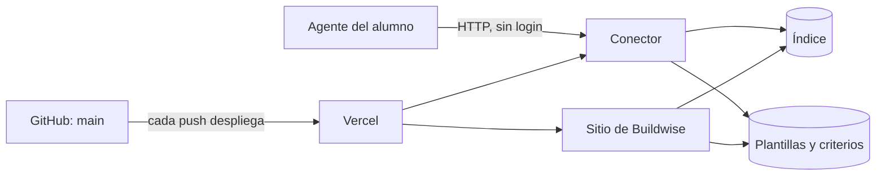

# Conector Buildwise — Diseño técnico

| Campo | Valor |
|-------|-------|
| **Estado** | Borrador |
| **Spec** | [Conector Buildwise](../specs/conector-buildwise.md) |
| **ADR relacionado** | [Distribuir el contenido del curso como servidor MCP](../adrs/distribuir-como-servidor-mcp.md) |

---

## 1. Contexto

La spec pide entregar al agente del alumno, sin login, las plantillas y los criterios tal como están en `main`. El ADR ya fijó que es un servidor MCP remoto y de solo lectura. Este diseño decide cómo se arma: el conector vive dentro del sitio que ya se publica en Vercel desde `main`, lee los mismos archivos que el sitio y se publica con el mismo despliegue. Por eso lo que ve el alumno es siempre lo que ve el sitio, sin copia ni sincronización.

**Qué no decide este diseño**
- Qué librería de MCP se usa: es implementación y la elige el agente al construir.
- Cómo escala: son pocos archivos pequeños y el uso es el de un curso; no lo exige.
- Los pendientes del ADR sobre cuándo revisarlo: siguen donde están.
- Las capacidades de fase 2 (B8, B9): el diseño no las bloquea, pero tampoco las diseña.
- Qué telemetría se mide en el taller 11: aquí solo se deja de dónde sale (ver "Riesgos y operación").

## 2. Componentes y responsabilidades

- **Agente del alumno** (existente) — hace el pedido y decide cuándo usar el conector. Es ajeno: este diseño solo influye en él por lo que el conector le dice de sí mismo.
- **Conector** (nuevo) — recibe los pedidos del agente y responde con el contenido o con "no existe". No interpreta nombres, no adapta, no escribe.
- **Índice** (nuevo) — la lista de plantillas y criterios con su descripción de una línea y los otros nombres con que se les conoce. Ver "Datos".
- **Plantillas y criterios** (existente) — los archivos de `templates/` y `criterios/`. No cambian; quien los edita sigue siendo el curso.
- **Sitio de Buildwise** (modificado) — hoy mantiene sus propias listas de plantillas y criterios, que son una segunda lista paralela a la que el conector necesita. Pasa a leer los nombres del índice; sus páginas no cambian para quien las lee. El conector va dentro de este mismo sitio.
- **Vercel y `main`** (existentes) — publican el sitio en cada cambio a `main`. Publican también el conector; no hay despliegue aparte.
- **Servidor local del spike del taller 2** (existente, descartado) — no se reutiliza ni se mantiene; el ADR ya lo dejó como prueba.

## 3. Flujo

**Camino normal:** agente → conector → índice (¿existe ese nombre?) → archivo publicado → respuesta con el texto sin tocar.

**Si el nombre no está en el índice:** el conector lo detecta antes de leer nada, responde que no existe y adjunta la lista (cómo se compara el nombre, en "Reglas").

**Si el índice y los archivos no coinciden:** el conector responde que ese contenido no está disponible, lo registra y no entrega nada a medias. Cómo se evita que llegue a producción, en "Reglas".

**Si el pedido trae varias cosas** (la plantilla y los criterios de un documento): el agente hace una llamada por elemento; ninguna herramienta recibe varios nombres.

**Si el pedido llega dos veces o se corta a la mitad:** no pasa nada. El conector no guarda estado entre pedidos y solo lee; repetir devuelve lo mismo, y un corte no deja nada a medias.

**Si el conector no responde:** lo detecta el cliente del alumno, no el conector. Qué ve el alumno está en "Riesgos y operación".

## 4. Reglas que no se rompen

- **El nombre que llega nunca se usa para armar una ruta de archivo.** Solo se compara con el índice; si no está, no existe. Así un nombre con `../` o con una ruta no puede leer nada fuera de la lista.
- **La comparación del nombre ignora mayúsculas y espacios al inicio y al final, y nada más.** `PRD` y ` prd ` son `prd`; `prd.md` no existe (el error trae la lista y el agente corrige en el siguiente intento). Un nombre vacío o solo de espacios se trata como el pedido sin nombre del caso 9 de la spec: se responde que falta el nombre y se adjunta la lista, no se elige una plantilla.
- **Ningún paso entre el archivo y la respuesta cambia el texto.** Sin recortar, sin encabezado propio, sin resumir, sin dividir en partes. Es lo que permite comprobar la identidad con el archivo.
- **Hay una sola lista de lo publicado: el índice.** El conector, el sitio y la lista que ve el alumno salen de ahí. Una comprobación compara el índice con los archivos de las carpetas (un archivo sin entrada o una entrada sin archivo la hacen fallar). Hoy no hay integración continua que la corra ni nada que bloquee el despliegue: la corre a mano quien hace el cambio, con las pruebas del proyecto, antes de hacer merge. Que bloquee el despliegue queda pendiente.
- **El conector no guarda nada entre pedidos.** Cualquier instancia responde igual; no hay sesiones.
- **La descripción de cada elemento dice qué es y para qué se usa**, y la de un criterio dice qué documento revisa o qué decide. Si no, el agente no puede elegir entre una plantilla y unos criterios sin abrir ambos. Cabe en una línea; los sinónimos no van en ella (ver "Datos").

## 5. Datos

**Índice** (nuevo) — una entrada por plantilla o criterios publicados, con su nombre (el del archivo sin extensión), si es plantilla o criterios, una descripción de una línea y, aparte, los otros nombres con que se le conoce ("brief", "spec"). Responde la pregunta abierta de dónde se guarda esa descripción (CONECTOR-12). La lista muestra ambos campos junto a cada elemento.
- Lo escribe quien agrega o cambia el archivo, en el mismo cambio que el archivo, y se versiona en el repositorio. No se escribe en el archivo mismo.
- Los otros nombres van en su propio campo para que la descripción siga siendo una línea legible para el alumno.
- Las primeras entradas salen de leer cada archivo existente (ver "Migración" en "Riesgos y operación").
- No tiene estados. Existe mientras exista el archivo.

**Plantillas y criterios** (existentes) — sin cambios. El conector solo los lee, y llegan a él como parte del despliegue (ver decisión sobre cómo se sirve el contenido).

No se guarda nada del alumno ni de sus pedidos.

## 6. Contrato externo

**Dirección:** una sola dirección pública del propio sitio, por HTTP, sin login ni credenciales. [PENDIENTE: la dirección exacta] Quien lo usa la configura una vez en su agente y no vuelve a tocarla: el contenido se actualiza en el servidor.

**Instrucciones del servidor** (texto que el cliente puede cargar al conectarse). Dicen:
- qué es el conector y cuándo usarlo: al pedir una plantilla o unos criterios, y también cuando el alumno pregunta con qué documento empezar o cómo revisar uno;
- qué hay hoy, con la descripción de cada elemento, armado desde el índice;
- que el contenido se muestra tal cual, que no se escribe uno propio cuando el curso no lo tiene y que, si el conector falla, se le dice al alumno (las descripciones de las herramientas dicen lo mismo);
- que la lista de las instrucciones se arma al conectarse y puede estar vieja en una sesión larga: ante la duda, la fuente actual es la herramienta de lista.

**listar_plantillas_y_criterios**
- **Recibe:** nada.
- **Devuelve:** dos listas, plantillas y criterios, cada elemento con su nombre, su descripción y los otros nombres con que se le conoce. Texto legible, sin identificadores internos.
- **Si falla:** respuesta marcada como error que dice que la lista no está disponible y que no se invente una.

**obtener_plantilla**
- **Recibe:** `nombre` (obligatorio), el nombre de la plantilla tal como lo muestra la lista. Texto libre.
- **Devuelve:** el contenido de la plantilla, solo el texto del archivo.
- **Si falla:** si el nombre no existe o viene vacío, respuesta marcada como error que dice qué se pidió (o que falta el nombre), que el curso no lo tiene y la lista completa. Si el nombre existe como criterios y no como plantilla, lo dice y señala la otra herramienta. Si el contenido no se puede leer, respuesta marcada como error que dice que no está disponible.

**obtener_criterios**
- **Recibe:** `nombre` (obligatorio), el nombre de los criterios tal como lo muestra la lista. Texto libre.
- **Devuelve:** el contenido de los criterios, solo el texto del archivo.
- **Si falla:** igual que `obtener_plantilla`. Un documento que solo tiene plantilla es el caso 7 de la spec.

Ninguna herramienta escribe: CONECTOR-18 se cumple porque no existe ninguna que cree, cambie o borre. Además las tres se declaran de solo lectura y sin acceso al exterior, que es un aviso al cliente, no una garantía. Las descripciones de cada herramienta, escritas como para alguien nuevo en el equipo, dicen cuándo usarla y cuándo no ("plantilla" es la estructura para escribir un documento; "criterios" son las preguntas para revisarlo o decidir algo).

## 7. Decisiones y alternativas

Referencia para las herramientas: [Writing effective tools for agents](https://www.anthropic.com/engineering/writing-tools-for-agents). Donde una recomendación cambió una decisión, se dice.

### Herramientas, no recursos ni prompts

- **Alternativa descartada: recursos.** Un recurso es contenido con dirección propia (una plantilla sería uno). El protocolo los define como controlados por la aplicación, no por el modelo: es el cliente quien decide cómo se muestran y si el modelo puede leerlos sin que el alumno los elija. Con eso no podemos prometer que el agente los use ante un pedido cualquiera, que es lo que miden CONECTOR-5 a 11. Algunos clientes lo permiten; no se verificó en todos los que usan los alumnos.
- **Alternativa descartada: prompts.** Son plantillas de instrucción que el usuario invoca de forma explícita (por ejemplo, con un comando). Sirven para algo distinto: arrancar un flujo, no responder a un pedido en lenguaje natural. El alumno no tendría que saber que existen.
- **Por qué esta:** las herramientas son lo único que el modelo decide usar por sí mismo a partir del pedido. Recursos y prompts pueden sumarse después sobre el mismo índice sin romper nada; no hacen falta para esta versión.

### Tres herramientas: una lista y dos para obtener, sin búsqueda

- **Alternativa descartada: una herramienta por documento.** Cada archivo nuevo sería una herramienta nueva, y la lista de herramientas la guardan los clientes: lo nuevo no le llegaría al alumno sin reconectar, lo contrario de CONECTOR-16.
- **Alternativa descartada: una sola herramienta con el tipo como parámetro.** Es lo más corto, pero deja la confusión que más cuida la spec (plantilla contra criterios, CONECTOR-5 y 15) dentro de un parámetro, donde una descripción no la puede distinguir. Con dos herramientas, elegir cuál llamar ya es elegir entre plantilla y criterios.
- **Alternativa descartada: una herramienta de búsqueda.** Devolvería lo que "se parece" al pedido, y la spec exige entregar el archivo exacto y la lista exacta (CONECTOR-1 a 4). Una búsqueda agrega un punto donde el resultado cambia según cómo se redacte el pedido.
- **Por qué esta:** son pocas, sin solaparse, y cada una hace una sola cosa. La lista existe porque el pedido sin nombre (caso 9) y el error de "no existe" la necesitan.
- **Cambia por el artículo:** el artículo recomienda preferir búsqueda a lista cuando la lista es grande, y respuestas concisas o paginadas para ahorrar contexto. No se adoptan: la lista es corta, de una línea por elemento, y cada archivo cabe de sobra en lo que los clientes aceptan por respuesta. Recortar contradice la identidad con el archivo. Se vuelve a mirar si la lista pasa de unas treinta entradas (estimación, sin medir). Sí se adoptan sus otras recomendaciones: nombres que dicen qué hacen y no dependen de un prefijo (los clientes ya anteponen el nombre del servidor), descripciones con cuándo usar y cuándo no, y errores que dicen qué hacer en vez de un código.

### Un nombre inexistente es una respuesta, no una falla del protocolo

Responde el pendiente de qué sinónimos e idiomas reconocer: quien traduce "brief" o "PRD template" es el agente, con la ayuda de los otros nombres del índice. Se garantizan los que el curso escriba ahí; el resto depende del agente y se mide en el taller 10.

- **Alternativa descartada: error de protocolo.** El modelo no siempre lo ve y, cuando lo ve, es un código sin la lista que necesita para corregirse.
- **Alternativa descartada: restringir el nombre a los valores válidos en la definición de la herramienta.** Es lo que sugiere el artículo (tipos estrictos), pero esa definición queda guardada en el cliente: un archivo nuevo no sería aceptado hasta reconectar. Se valida en el servidor.
- **Alternativa descartada: tabla de sinónimos en el servidor.** Es una segunda lista que mantener, y el agente ya traduce idiomas y apodos mejor que una tabla.
- **Por qué esta:** una respuesta marcada como error, con la lista adjunta, le da al agente todo lo que necesita para corregirse en el siguiente intento.
- **Cambia por el artículo:** la regla de que los errores sean accionables convirtió "no existe" en "no existe, esto sí existe" también para la herramienta de criterios (CONECTOR-14).

### El contenido viaja con el despliegue del sitio

Responde el pendiente de cuánto tarda en llegar un cambio (camino 5, CONECTOR-16): el conector no agrega espera propia, tarda lo que tarda el despliegue. Cuánto es, se mide en el primer despliegue. [PENDIENTE: ver "Preguntas abiertas"]

- **Alternativa descartada: pedirlo a GitHub en cada pedido.** Es la versión más fresca, pero el límite de pedidos sin cuenta de GitHub es bajo y se comparte entre todos los usuarios de la misma plataforma; el curso entero podría agotarlo. Con una cuenta de servicio habría un secreto que cuidar y una dependencia más que puede caerse.
- **Alternativa descartada: copiar el contenido a un almacenamiento propio.** Agrega un segundo lugar donde vive el contenido y un paso de sincronización que puede olvidarse; es exactamente el problema del alumno que copia a mano, ahora del curso.
- **Por qué esta:** `main` y la versión publicada del sitio son lo mismo, y "publicado" para la spec es lo que está en `main`. No hay dependencia externa en tiempo de pedido.

### El agente llega por HTTP directo, sin puente local

- **Alternativa descartada: puente local** (un paquete en el equipo del alumno que habla con el servidor remoto). Funcionaría con clientes que solo hablan con procesos locales, pero reintroduce lo que el ADR descartó: algo instalado que se desactualiza, además de pedir un entorno de ejecución que no sabemos si todos tienen.
- **Alternativa descartada: el transporte antiguo de MCP con eventos.** El propio estándar lo da por obsoleto.
- **Por qué esta:** es el transporte que el estándar define para servidores remotos. Es una sola dirección, sin sesiones, y no hay nada que instalar ni actualizar. El costo: un cliente que no sepa hablar con servidores remotos no puede usarlo; es una limitación conocida (ver ADR) y está en las preguntas abiertas de la spec del taller 4.

### El conector va dentro del sitio

- **Alternativa descartada: otro proyecto en Vercel, en el mismo repositorio.** Se despliega y falla por separado, pero necesita leer los mismos archivos y el mismo índice, así que habría que sacarlos a un paquete compartido o copiarlos. Es más estructura de la que la funcionalidad justifica.
- **Alternativa descartada: otro proveedor** (un servicio de contenedores o de funciones en el borde). Un despliegue más, una cuenta más y una dirección más, sin ganar nada que el volumen pida.
- **Por qué esta:** el contenido, el despliegue y la dirección ya existen. Cuesta: el conector y el sitio comparten despliegue, así que un sitio que no compila también deja sin actualizar al conector, y el rollback revierte los dos.

### El agente se entera del conector por las instrucciones del servidor

Intenta responder el pendiente del pedido que no nombra el artefacto (caso 13); el resultado se mide en el taller 10 y no es un criterio de esta versión.

- **Alternativa descartada: depender solo de la descripción de las herramientas.** En algunos clientes las herramientas se cargan solo cuando se buscan por nombre, y una descripción que nadie ha cargado no ayuda a decidir si buscar. Fue lo que se probó en el spike del taller 2 y falló en el pedido indirecto.
- **Alternativa descartada: pedirle al alumno que agregue una línea a las instrucciones de su proyecto.** Funcionaría, pero es copiar a mano algo que el conector debería traer, y contradice "sin tocar la estructura de su proyecto".
- **Por qué esta:** las instrucciones del servidor las cargan los clientes al conectarse, antes de cualquier pedido. Llevan la lista armada desde el índice, así que un archivo nuevo aparece en cada conexión nueva sin editar nada más. En una sesión ya abierta la lista puede estar vieja: por eso las instrucciones mandan a la herramienta de lista como fuente actual, y por eso esto no contradice descartar una herramienta por documento: las instrucciones orientan, y lo que entrega el contenido siempre es una herramienta que lee en el momento. Es otra decisión que la de la herramienta de lista: si la lista supera unas veinte entradas (estimación, sin medir), las instrucciones llevan solo la regla, porque se pagan en el contexto de cada sesión. Es una hipótesis: no sabemos si basta para el pedido indirecto.

### La descripción vive en un índice aparte, no en los archivos ni en el sitio

Responde el pendiente de dónde se guarda la descripción de una línea y cómo se mantiene.

- **Alternativa descartada: en el encabezado de cada archivo.** Cambiaría el texto que se entrega (rompe la identidad con el archivo) y el sitio lo mostraría como contenido.
- **Alternativa descartada: sacarla del primer párrafo de cada archivo.** Las plantillas empiezan con un comentario de instrucciones, no con una descripción; extraerla sería adivinar.
- **Alternativa descartada: dejarla en las listas del sitio.** Sigue siendo una lista aparte de la carpeta, la que se desalinea.
- **Por qué esta:** un solo lugar, versionado con el contenido, y escrito por quien agrega el archivo.
- **Decisión que no va en un ADR:** que el índice sea la única lista y que el conector viva en el sitio cambia cómo se agrega una plantilla al curso. No hay ADR ni convención previa que lo cubra (los tres ADR existentes tratan el formato de los talleres, la presentación en clase y el servidor MCP). No se escribe uno ahora porque afecta solo a este contenido, se revierte con un cambio y la regla la hace cumplir la comprobación del índice. Si esa comprobación pasa a bloquear el despliegue, se vuelve a decidir.

## 8. Riesgos y operación

- **Seguridad:** todo el contenido es público y no hay cuentas ni datos del alumno. El conector solo lee, y lo que llega como nombre no puede salirse de la lista (ver "Reglas"). Un navegador no es un cliente esperado: la lista de orígenes permitidos queda vacía, así que un pedido que traiga origen de navegador recibe 403 (lo que pide el estándar) y los agentes, que no mandan origen, pasan. No se verificó si algún cliente de los alumnos manda origen. [PENDIENTE: ver "Preguntas abiertas"] Al ser público, cualquiera puede llamarlo muchas veces y costar uso del sitio. [PENDIENTE: si hace falta un límite de pedidos; ver "Preguntas abiertas"]
- **Migración:** no hay conector anterior, pero sí cambia el sitio. En un mismo cambio: se crea el índice con las descripciones de los archivos que ya existen (las escribe Freider Achic leyendo cada uno, con los otros nombres del curso, "brief" y "spec"), y las dos listas paralelas del sitio dejan de existir y pasan a salir del índice. Se comprueba que el sitio muestra las mismas páginas y la misma barra lateral que antes.
- **Rollback:** volver al despliegue anterior en Vercel, o revertir el cambio en `main`. Es el mismo despliegue del sitio, así que revierte ambos, y también un contenido mal publicado. Las listas antiguas del sitio vuelven con el cambio revertido. Los alumnos no hacen nada: la dirección es la misma.
- **Si se cae:** el cliente del alumno muestra su propio error de conexión o de herramienta; lo que el conector controla es lo que el agente hace con eso, que está dicho en "Contrato externo". Si lo cumple se verifica al depurar, en el taller 10. Quien mantiene se entera de dos formas: el despliegue de Vercel falla, o los registros del sitio muestran errores del conector. Cada pedido deja un registro con la herramienta, si salió bien o falló y, solo cuando el nombre coincide con el índice, ese nombre; un nombre que no coincide se registra como "no existente", porque es texto libre del alumno y podría llevar datos personales. Se conserva lo que la plataforma conserve de sus registros; el diseño no guarda más. De ahí saldrá la medición del taller 11. [PENDIENTE: aviso automático cuando falle y cuánto conserva la plataforma; ver "Preguntas abiertas"]

## 9. Preguntas abiertas

- [PENDIENTE: cuánto tarda hoy un cambio en `main` en llegar al conector, para fijar el valor de CONECTOR-16] — Freider Achic, midiéndolo en el primer despliegue del conector (taller 5).
- [PENDIENTE: la dirección pública del conector] — Freider Achic, al publicarlo (taller 5).
- [PENDIENTE: que la comprobación de índice contra archivos bloquee el despliegue; hoy no hay integración continua y se corre a mano] — Freider Achic, antes de publicar (taller 5).
- [PENDIENTE: límite de pedidos, aviso cuando el conector falle y cuánto conserva la plataforma de sus registros] — Freider Achic, después de ver el primer uso real (taller 11).
- [PENDIENTE: si los clientes que usan los alumnos se conectan por HTTP sin pasos extra y si alguno manda origen de navegador] — ya está en la spec del taller 4; el docente, antes del ensayo.
- [PENDIENTE: si las instrucciones del servidor bastan para el pedido que no nombra el artefacto] — se mide en las evaluaciones del taller 10; si no bastan, se reabre la decisión de cómo se entera el agente.
