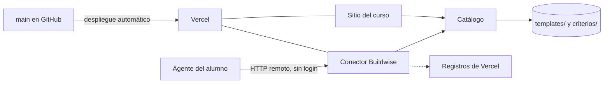

# Conector Buildwise — Diseño técnico

| Campo | Valor |
|-------|-------|
| **Estado** | Borrador |
| **Spec** | [Conector Buildwise](../specs/conector-buildwise.md) |
| **ADR relacionado** | [Distribuir el contenido del curso como servidor MCP](../adrs/distribuir-como-servidor-mcp.md) |

---

## 1. Contexto

La spec pide que el agente del alumno reciba, sin login, las plantillas y los criterios publicados tal como están en `main`. El ADR ya decidió la forma: un servidor MCP remoto y de solo lectura. Este diseño decide el resto: qué expone, de dónde saca el contenido, cómo llega el agente y dónde corre.

La idea central: el conector es una ruta más del sitio que ya se despliega en Vercel desde `main`. Lee los mismos archivos que el sitio, desde una sola lista, y los entrega sin tocarlos mediante dos herramientas: una lista y una que entrega.

**Qué no decide este diseño**
- Cómo escala: el contenido son siete archivos de menos de 6 KB cada uno (unos 19 KB en total) y el uso es de un curso. No hay caché propia, cola ni base de datos.
- Cómo se hace que el agente use el conector con pedidos que no nombran el artefacto: es una pregunta abierta de la spec. Aquí solo se fija qué se intenta (ver "Contrato externo") y se deja el resultado a las evaluaciones del taller 10.
- Las capacidades de fase 2 (B8, B9): fuera de esta versión. Que vivan en el mismo servidor es una de las razones para dejar el conector como un componente propio dentro del sitio y no como un archivo suelto.

## 2. Componentes y responsabilidades

- **Conector Buildwise** (nuevo) — recibe los pedidos del agente, resuelve cada identificador contra el catálogo y devuelve el contenido. De qué no se encarga: interpretar lo que quiso decir el alumno (eso lo hace su agente), adaptar o resumir el contenido, recordar nada entre pedidos.
- **Catálogo** (nuevo; reemplaza las dos listas del sitio) — hoy el sitio tiene dos listas, una de plantillas y otra de criterios, y cada entrada carga el archivo como página compilada desde MDX: sirve para dibujar la página, no para entregar el texto del archivo. El catálogo las reemplaza con una sola lista: por cada elemento, su identificador, su tipo, su descripción de una línea y dónde está el archivo. El sitio sigue dibujando sus páginas desde esa lista; el conector lee de ella el texto original, como texto y sin pasar por MDX. No conviven dos listas: una segunda podría diferir de lo publicado (CONECTOR-4).
- **Contenido de `templates/` y `criterios/`** (existente) — la fuente. No cambia de formato ni gana encabezados: lo que se entrega es el archivo.
- **Sitio del curso** (modificado) — aloja el conector. Sus páginas se ven igual; cambia que lee el catálogo nuevo en vez de las dos listas.
- **Vercel y `main`** (existente) — cada cambio en `main` se despliega solo. Ese despliegue es lo que "publica" el cambio para el conector.
- **Registros de Vercel** (existente) — donde queda el uso medible que pide el ADR para el taller 11. No se agrega otro sistema de métricas.
- **Agente del alumno** (externo) — decide cuándo llamar, qué pedir y cómo presentar la respuesta.

## 3. Flujo

**Camino normal:** el agente llama una herramienta del conector → el conector resuelve los identificadores contra el catálogo → lee el contenido incluido en el despliegue → responde → deja una línea en los registros.

**Si el identificador no existe** (incluye pedir un tipo que no corresponde, como criterios de un documento sin criterios): el conector lo detecta al buscar en el catálogo, no lee nada y responde que no existe, con la lista de lo que sí hay. No hay búsqueda aproximada ni sustituto.

**Si el pedido trae varios identificadores y algunos no existen:** devuelve completos los que existen y, por cada uno que no existe, el aviso con la lista. Marca la respuesta como error para que el agente no pase por alto el aviso.

**Si el contenido no se puede leer** (por ejemplo, el despliegue salió sin los archivos): responde un error que dice que el conector falló y pide al agente decírselo al alumno. Nunca devuelve contenido parcial. Queda el error en los registros.

**Si el pedido llega dos veces o se corta a la mitad:** no pasa nada. El conector es de solo lectura y no guarda estado entre pedidos, así que repetir un pedido da la misma respuesta y un pedido cortado se reintenta completo.

## 4. Reglas que no se rompen

- **El contenido sale sin tocar y la etiqueta va aparte.** Cada archivo se entrega en su propio bloque, sin encabezado ni pie agregado por el conector; el identificador va en un bloque anterior. Si se mezclan, el agente puede copiar la etiqueta como parte de la plantilla del alumno.
- **Una sola lista de archivos, y el despliegue falla si no coincide con las carpetas.** Un archivo publicado sin entrada en el catálogo, una entrada sin archivo o una entrada sin descripción rompe el despliegue en vez de dejar un conector que miente en la lista. Es lo que hace comprobable CONECTOR-4 y CONECTOR-12. Hoy nada compara las listas con las carpetas: esta comprobación es nueva, y como las pruebas del proyecto no corren en el despliegue, debe correr dentro de la construcción en Vercel, no solo con las pruebas locales.
- **El identificador lleva el tipo y se compara exacto.** Una plantilla y unos criterios pueden llamarse parecido; sin tipo en el identificador habría que adivinar, y adivinar es como se acaba entregando la plantilla donde se pidieron criterios.
- **Sin estado entre pedidos.** Cada pedido se responde solo con lo que trae. Es lo que permite correr en funciones sin servidor y que dos pedidos simultáneos no se afecten.
- **El conector no escribe nada.** Ninguna herramienta modifica ni recibe contenido (CONECTOR-18); se declara de solo lectura y cerrada al exterior para que el agente del alumno no pida confirmación de más.
- **Solo la dirección de producción se publica a los alumnos.** Los despliegues de ramas sirven contenido sin publicar.

## 5. Datos

**Catálogo** (nuevo) — la lista única de plantillas y criterios publicados; reemplaza las dos listas del sitio (ver "Componentes y responsabilidades").
- Guarda, por elemento: identificador, tipo, descripción de una línea y dónde está el archivo.
- Quién lo cambia: quien agrega o cambia un archivo del curso, en el mismo cambio que el archivo. Sin entrada completa, el despliegue falla (ver "Reglas que no se rompen").

**Uso del conector** (nuevo) — una línea por llamada en los registros de Vercel: qué herramienta, qué identificadores publicados se pidieron, cuántos pedidos no existían y si hubo error. Los identificadores que no existen no se registran literales: son texto libre que escribe el agente y podrían contener lo que el alumno dijo. Se pierde saber qué documentos inexistentes piden los alumnos; si hace falta esa señal, se reconsidera. Lo lee quien mantiene el curso; nadie lo cambia. Retención: la del plan de Vercel, que puede no llegar al taller 11; ver "Preguntas abiertas".

El contenido de los archivos no se copia a ningún otro almacenamiento.

## 6. Contrato externo

**Cómo se llega.** Es un servidor MCP remoto por HTTP, sin login ni credenciales (CONECTOR-17). El alumno lo agrega a su agente con solo la dirección: la del sitio en producción más la ruta del conector. [PENDIENTE: dirección de producción final del sitio]. Es lo más caro de cambiar: cambiarla obliga a cada alumno a reconfigurar.

**Instrucciones del servidor.** El conector declara dos frases a los clientes que las usen: qué es (plantillas y criterios del curso Buildwise) y qué hacer si falla (decírselo al alumno y no escribir de memoria una plantilla "parecida"). Es una de las palancas para la pregunta abierta de descubrimiento.

**`buildwise_listar`**
- **Recibe:** nada.
- **Devuelve:** texto con todas las plantillas y todos los criterios, una línea por elemento: su identificador y la descripción que escribió el curso, agrupados por tipo y siempre en el mismo orden.
- **Si falla:** error de herramienta con el mensaje del caso "contenido no legible".
- **Descripción de la herramienta:** explica en términos del alumno qué es cada tipo (la plantilla es la estructura de ejemplo de un documento; los criterios son preguntas para revisar un documento o para decidir algo) y dice cuándo llamarla: al empezar un documento, al pedir algo "del curso", o cuando el pedido no dice cuál.

**`buildwise_obtener`**
- **Recibe:** `ids`, una lista de al menos un identificador. Forma única: `plantilla/<nombre>` o `criterios/<nombre>`, donde `<nombre>` es el nombre del archivo sin extensión: `plantilla/prd`, `plantilla/product-brief`, `plantilla/adr`, `plantilla/diseno-tecnico`, `criterios/revisar-prd`, `criterios/revisar-diseno`, `criterios/que-probar`. Solo se acepta esa forma, exacta: ni títulos ("Revisar un PRD") ni variantes de mayúsculas o idioma; cualquier otra recibe el error de identificador inexistente con la lista.
- **Devuelve:** por cada identificador pedido, en el orden pedido, un bloque con el identificador y otro con el archivo exacto. Si la comprobación del taller 8 falla (ver "Preguntas abiertas"), el plan B cambia esta forma.
- **Si falla:**
  - *Identificador inexistente:* error de herramienta que nombra el identificador pedido, dice que el curso no lo tiene y lista lo que sí existe. Pide al agente no escribir uno propio. Los identificadores que sí existían van completos en la misma respuesta.
  - *Lista vacía:* error que dice que falta al menos un identificador y que se puede llamar a `buildwise_listar`.
  - *Contenido no legible:* error que dice que el conector falló y que se lo diga al alumno; no hay contenido parcial.
- **Descripción de la herramienta:** dice que entrega el texto completo y sin cambios, que para revisar un documento se piden los criterios y no la plantilla, que los identificadores salen de la lista, y que el agente adapta el contenido al proyecto del alumno después. Menciona las situaciones del alumno ("empezar un producto", "revisar mi documento") y no solo los nombres de los documentos.

Ambas herramientas se declaran de solo lectura, no destructivas y cerradas al exterior. Los nombres llevan el prefijo del servicio para no chocar con las herramientas de otros conectores que el alumno tenga.

## 7. Decisiones y alternativas

### Qué se expone: herramientas

- **Alternativa descartada:** recursos MCP — son "dirigidos por la aplicación": el cliente decide si los incluye y el alumno los adjunta a mano. El agente no los pide por su cuenta, y la spec exige que ante "¿cómo reviso mi PRD?" el agente traiga los criterios (CONECTOR-5 a 11). Además, un recurso que no existe es un error de protocolo sin lugar natural para la lista de lo que sí existe (CONECTOR-14).
- **Alternativa descartada:** prompts MCP — los elige el alumno, como un comando; el alumno tendría que saber qué comando escribir. No cubre el pedido en lenguaje natural. Podría sumarse después como atajo.
- **Por qué esta:** las herramientas son lo único que el modelo decide llamar según el pedido y que puede devolver un error con la lista adjunta. Es también lo que el spike del taller 2 probó (2 de 3). Exponer los mismos archivos también como recursos queda diferido: no hay un pedido que lo exija.

### Cuántas herramientas, y si listan o buscan: dos, una lista y una que entrega

- **Alternativa descartada:** una herramienta por archivo, como en el spike — crece con cada archivo que el curso agrega (hoy serían siete, y habría que renombrarlas, redescribirlas y redeclararlas), y el agente tiene que elegir entre muchas con descripciones parecidas. La guía de Anthropic sobre herramientas para agentes recomienda pocas herramientas para flujos de alto impacto, no una por recurso.
- **Alternativa descartada:** tres herramientas (lista, plantilla, criterios) — espeja los dos tipos de la spec, pero para pedir "la plantilla y los criterios de PRD" (CONECTOR-9) se necesitan dos llamadas, y la guía advierte que herramientas que se solapan empujan al agente a estrategias ineficientes.
- **Alternativa descartada:** una herramienta de búsqueda por texto — sirve cuando la lista no cabe en una respuesta. Aquí la lista entera son siete líneas; buscar agrega un caso (qué pasa si no encuentra, si encuentra dos) y la posibilidad de que el agente reciba la plantilla equivocada por parecido.
- **Alternativa descartada:** la lista dentro de la descripción de la herramienta — ahorraría una llamada, pero la lista de herramientas la guardan los clientes y se quedaría vieja tras un cambio (CONECTOR-16). Como resultado de una llamada, siempre es la vigente.
- **Por qué esta:** una lista que se pide cuando hace falta (CONECTOR-7, CONECTOR-8) y una herramienta que recibe varios identificadores a la vez (CONECTOR-9). Sigue la guía de Anthropic en dos puntos: consolidar, y devolver nombres legibles en vez de códigos opacos.
- **Recomendaciones de esa guía que cambian o no esta decisión:**
  - *Consolidar* — cambió la decisión: la idea inicial eran tres herramientas por los dos tipos de la spec; la guía llevó a dos.
  - *Buscar en vez de listar* — no aplica a este tamaño; sí aplicaría si el catálogo creciera a decenas de elementos. Se revisa entonces.
  - *Parámetro de detalle (conciso/detallado)* — descartada: la spec exige el contenido completo e idéntico (CONECTOR-1 a 3). El tamaño no obliga a recortar: el catálogo entero, unos 19 KB, cabe de sobra en el límite de respuesta que la guía cita para Claude Code (25 000 tokens).
  - *Errores que dicen qué hacer* — refuerza lo que la spec ya pide: el error de "no existe" incluye la lista y la instrucción de no inventar.
  - *Prefijo por servicio y descripciones escritas para alguien nuevo* — aplicadas (ver "Contrato externo").

### El identificador lleva el tipo

- **Alternativa descartada:** dos parámetros, tipo y nombre — con varios elementos hace falta una lista de pares; es más fácil que el agente arme mal un par que copie un identificador de la lista.
- **Alternativa descartada:** solo el nombre — una plantilla y unos criterios pueden llamarse parecido; el conector tendría que decidir cuál entregar.
- **Por qué esta:** una sola cadena que se copia de la lista, y el tipo no se puede confundir.

### Cómo se sirve el contenido: incluido en cada despliegue

- **Alternativa descartada:** leer de GitHub (`main`) en cada pedido — llega al instante, pero el conector depende de que GitHub responda, tiene límite de pedidos sin credenciales y entregaría un cambio roto antes de que el despliegue lo compruebe.
- **Alternativa descartada:** copiar el contenido a un almacenamiento aparte (base de datos o almacén de archivos) con un paso de sincronización — agrega un sistema que mantener y un momento en que el sitio y el conector difieren, para siete archivos.
- **Por qué esta:** el sitio ya publica desde `main` y ya lee estos archivos; el conector entrega lo que el despliegue trae. "Publicado" (la definición de la spec) queda igual a "lo que el último despliegue de `main` incluye", y la lista y el contenido salen de la misma versión.
- **Respuesta a la pregunta abierta de CONECTOR-16:** el cambio llega cuando termina el despliegue de `main`; no hay caché propia entre el despliegue y la respuesta. Objetivo: 10 minutos desde que el cambio llega a `main`. Se mide en los primeros cambios reales.

### Dónde viven las descripciones de una línea: en el catálogo

- **Alternativa descartada:** encabezado dentro de cada archivo — el conector entregaría un archivo distinto al publicado, y no cumple CONECTOR-1 a 3; además el sitio mostraría el encabezado.
- **Alternativa descartada:** sacarla del título o del primer párrafo del archivo — las plantillas empiezan con un comentario largo y los títulos no dicen cuándo usar el documento. Quedaría una descripción que nadie escribió para ese fin (CONECTOR-12 pide la que "escribió el curso").
- **Por qué esta:** junto a la lista que ya se mantiene para cada archivo, y obligatoria porque el despliegue falla sin ella. Responde la pregunta abierta de la spec sobre dónde se guarda y cómo se mantiene.

### Cómo llega el agente al servidor: HTTP remoto directo

- **Alternativa descartada:** un puente local (proceso en la máquina del alumno que reenvía al servidor) — para agentes que solo hablan con procesos locales. Obliga a instalar algo y a mantenerlo al día: es el problema que el ADR descartó para las skills. Queda como indicación aparte para esos agentes, no como camino principal.
- **Alternativa descartada:** servidor local instalado como paquete — ya rechazado en el ADR (copia que el alumno tiene que actualizar).
- **Alternativa descartada:** el transporte antiguo con conexión abierta y sesión — mantiene estado por conexión, que no calza con funciones sin servidor ni con la regla de no guardar estado. El transporte HTTP de pedido y respuesta alcanza para herramientas que responden de una vez.
- **Por qué esta:** el alumno agrega una dirección y nada más; no instala ni actualiza nada (spec, sección 1 y CONECTOR-16).

### Si va dentro del sitio o aparte: dentro del sitio

- **Alternativa descartada:** otro proyecto de Vercel con su propio repositorio o carpeta — habría que traer o sincronizar los archivos del curso, y dos despliegues pueden dejar el sitio y el conector en versiones distintas.
- **Alternativa descartada:** otro proveedor de funciones (por ejemplo, funciones en el borde de otra plataforma) — es otro proveedor, otra cuenta y otro despliegue por una ruta que corre bien donde ya se publica el sitio.
- **Por qué esta:** un solo despliegue, un solo lugar donde ver errores, y el contenido ya está en el mismo repositorio. Costo aceptado: un fallo de construcción del sitio también bloquea al conector, y volver a un despliegue anterior los revierte a los dos. Se revisa si el conector necesita un acceso distinto, otro ritmo de despliegue o, en fase 2, permisos sobre el repositorio del alumno.

### Sinónimos e idiomas: los resuelve el agente, no el servidor

- **Alternativa descartada:** tabla de alias en el servidor ("brief", "spec", "PRD template") — crece con cada palabra que un alumno invente y hay que mantenerla; siempre quedará una palabra fuera.
- **Alternativa descartada:** búsqueda aproximada en el servidor — responde con el elemento más parecido, que es justo lo que las reglas prohíben (puede entregar la plantilla donde se pidieron criterios).
- **Por qué esta:** el agente ya entiende "brief", "spec" o "PRD template". Si ninguna descripción le sirve, llama a la lista y elige con las descripciones del curso. Si el pedido no coincide con nada, el error le devuelve la lista. El contenido siempre sale en español, tal como está publicado. Si las evaluaciones del taller 10 muestran fallos con ciertas palabras, se agregan a la descripción de ese elemento en el catálogo, no al servidor.

## 8. Riesgos y operación

- **Seguridad:** todo es público y de solo lectura, igual que el repositorio; no hay cuentas ni datos del alumno. Los pedidos solo traen identificadores, que se validan contra el catálogo antes de leer nada, así que no se puede pedir un archivo fuera de la lista. Abuso y costo: sin límite propio, el conector llama funciones que Vercel cobra o limita según el plan. Se usan los límites de la plataforma. [PENDIENTE: confirmar que el plan de Vercel permite una regla de límite de pedidos]. Los despliegues de ramas pueden mostrar contenido sin publicar; la dirección que se da a los alumnos es solo la de producción.
- **Migración:** no aplica a datos ni a usuarios: no hay nada guardado. Lo único que cambia es la lista que ya usa el sitio; sus páginas deben verse igual después del cambio. El servidor del spike no se reutiliza (ADR).
- **Rollback:** volver al despliegue anterior en Vercel o revertir el cambio en `main`. La dirección no cambia, así que los alumnos no reconfiguran nada. Revierte el sitio y el conector juntos.
- **Si se cae:** el alumno ve el fallo de conexión de su agente. El servidor no puede decir nada si no responde; lo que sí puede es pedir, en las instrucciones y en cada error propio, que el agente avise al alumno y no escriba una plantilla de memoria. Si el agente no lo hace, es el caso de la spec (camino 8), que se revisa al depurar en el taller 10. Quien mantiene se entera por los errores en los registros de Vercel y por los despliegues fallidos. [PENDIENTE: aviso de disponibilidad (un chequeo externo periódico de la dirección)].

## 9. Preguntas abiertas

- [PENDIENTE: ¿se puede lograr que el agente use el conector cuando el pedido no nombra el artefacto?] — Este diseño intenta dos palancas: descripciones escritas con situaciones del alumno y las instrucciones del servidor. Se mide en las evaluaciones del taller 10; en construcción (taller 8) se comprueba con pedidos redactados distinto.
- [PENDIENTE: ¿los clientes entregan bien al modelo la pareja "bloque de etiqueta + bloque de contenido", sin juntarlos ni recortarlos?] — Freider Achic lo comprueba en el taller 8 con Claude Code y al menos otro cliente, antes de dar por buena la regla de la etiqueta aparte. Plan B, si falla: devolver cada archivo como recurso incrustado, con el identificador como su dirección y el texto intacto, de modo que la etiqueta no vive en el texto. Plan C, si tampoco se entrega bien: etiqueta y archivo en el mismo bloque, con una línea que diga que la etiqueta no es parte del archivo; eso rompe "idéntico" tal como lo redactan CONECTOR-1 a 3, así que antes habría que cambiar la spec.
- [PENDIENTE: dirección de producción final del sitio] — Freider Achic, antes de publicar en el taller 9.
- [PENDIENTE: ¿los registros de Vercel se conservan hasta el taller 11, que es cuando el ADR pide medir el uso?] — Freider Achic lo confirma contra su plan antes de publicar (taller 9). Plan B, si no alcanza: exportar los registros a un lugar propio, o copiar el resumen de uso a mano antes de que venza la retención.
- [PENDIENTE: límite de pedidos y aviso de disponibilidad] — Freider Achic, al publicar en el taller 9, según el plan de Vercel.
- [PENDIENTE: ¿se cumple el objetivo de 10 minutos de CONECTOR-16?] — Se mide con los primeros cambios reales después de publicar; si no se cumple, se revisa aquí.
